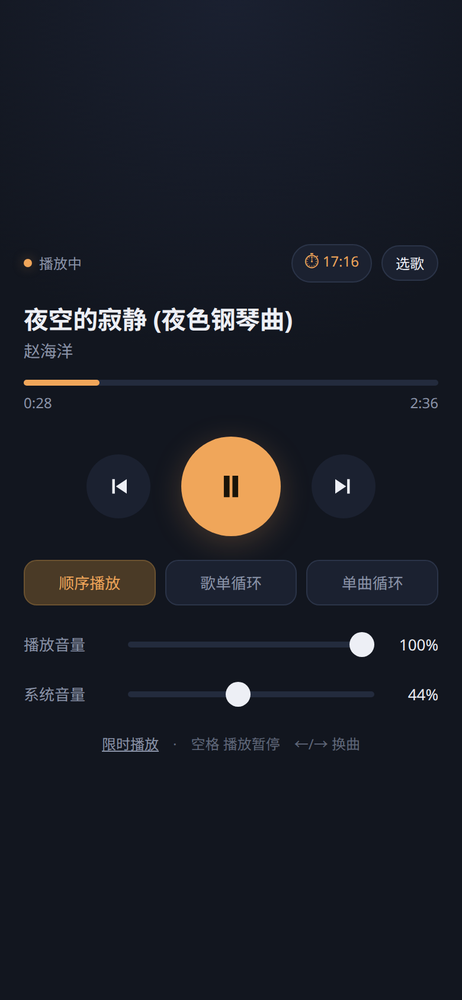
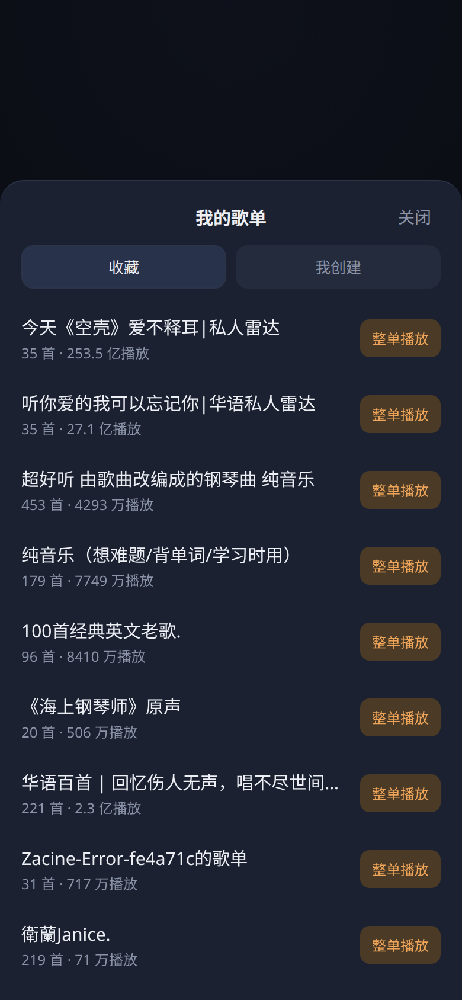
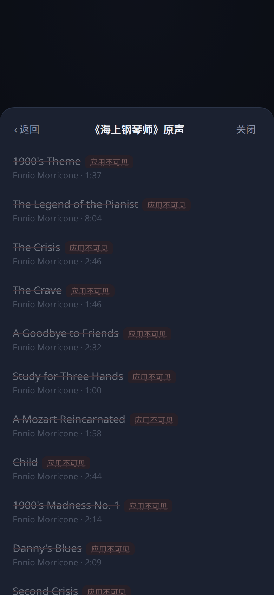

# ncm-cli-webui

给 [`ncm-cli`](https://music.163.com/st/ncmcli) 套一层局域网网页遥控器：手机上就能播放/暂停、换曲、拖进度、调音量、选歌单、设限时播放。

单文件 Python 标准库实现，零第三方依赖。

<p align="center">
  
  
  
</p>

## 为什么需要它

`ncm-cli` 本身只有命令行。这个页面把它的能力包成 HTTP 接口 + 移动端 UI，方便在家里用手机控制本机播放（比如给孩子放儿歌）。

## 功能

- 播放 / 暂停、上一首 / 下一首、进度拖拽、跳转
- 双音量：播放器音量（mpv）与系统音量（PipeWire/PulseAudio）分开控制
- 三种播放模式：顺序播放（播完即停）、歌单循环、单曲循环
- 限时播放：15 分钟 ~ 3 小时，到点自动停止，界面显示倒计时
- 选歌：浏览「我收藏的歌单」「我创建的歌单」→ 看曲目 → 点某一首直接播
- 点曲目时后台把该歌单后续曲目追加到队列，实现"从这首顺着播"
- 「继续上次」：daemon 还活着就原地续播，daemon 没了就重放上次的歌单
- 局域网访问 + token 鉴权，手机无需装 App

## 依赖

| 依赖 | 说明 |
|---|---|
| Python 3.9+ | 只用标准库（`http.server` / `socket` / `subprocess`） |
| `ncm-cli` | `npm i -g @music163/ncm-cli`，完成 `config set appId/privateKey` 与 `login` |
| `mpv` | 播放后端，`ncm-cli` 会自动拉起 |
| `pactl`（可选） | 控制系统音量，没有则「系统音量」滑块无效 |

## 运行

```bash
python3 server.py          # 默认 8787
python3 server.py 9000     # 自定义端口
```

启动后会打印带 token 的地址：

```
本机:   http://127.0.0.1:8787/?t=<token>
手机:   http://192.168.1.10:8787/?t=<token>
```

首次打开会把 token 写入 cookie（1 年有效），之后直接访问 `http://<ip>:8787/` 即可。

token 存在 `~/.config/ncm-webctl/token`，删掉重启会生成新的。

## 开机自启（systemd user）

```ini
# ~/.config/systemd/user/ncm-webctl.service
[Unit]
Description=ncm-cli 局域网遥控页面
After=default.target

[Service]
Type=simple
ExecStart=/usr/bin/python3 -u %h/path/to/server.py
Restart=on-failure
RestartSec=3

[Install]
WantedBy=default.target
```

```bash
systemctl --user daemon-reload
systemctl --user enable --now ncm-webctl
loginctl enable-linger "$USER"     # 未登录也启动
```

## 接口

| 方法 | 路径 | 作用 |
|---|---|---|
| GET | `/api/state` | 状态、曲名、进度、双音量、模式、限时剩余 |
| POST | `/api/toggle` | 播放 / 暂停 |
| POST | `/api/next` `/api/prev` | 下一首 / 上一首 |
| POST | `/api/seek` | `{seconds}` 绝对跳转 |
| POST | `/api/volume` | `{player}` 或 `{system}`，0-100 |
| POST | `/api/mode` | `{mode}`：`sequential` / `loop-list` / `loop-one` |
| POST | `/api/timer` | `{minutes}`，`0` 取消 |
| GET | `/api/my/playlists` | `?kind=collected\|created` |
| GET | `/api/playlist/info` | `?enc=<歌单加密ID>`（名字/曲目数） |
| GET | `/api/playlist/tracks` | `?enc=<歌单加密ID>`，含 `playable` / `reason` |
| POST | `/api/play/playlist` | `{enc, orig, name}` 整单播放 |
| POST | `/api/play/track` | `{songEnc, songOrig, index, playlistEnc, playlistOrig, playlistName}` |
| POST | `/api/resume-last` | 继续上次 |

所有接口都需要 token（cookie 或 `?t=`）。

## 实现要点

控制面分两路，各取所长：

- **mpv JSON IPC**（`~/.config/ncm-cli/mpv.sock`）：暂停、进度、播放器音量、单曲循环——毫秒级，直接和播放器对话。
- **`ncm-cli` 子进程**：曲名、队列、换曲、歌单与收藏数据。`state` 结果缓存 2 秒，避免手机轮询把 node 进程刷爆。

播放模式没有走 daemon（CLI 没有对外暴露模式接口），而是在这一层实现：

| 模式 | 做法 |
|---|---|
| 顺序 | daemon 默认行为 |
| 单曲循环 | `mpv set loop-file inf` |
| 歌单循环 | 检测到「停止」且此前确实在播 → 重放上次歌单，45 秒冷却防抖 |

## 已知限制

- **歌单循环重放有约 3 秒空隙**：daemon 一次只喂 mpv 一首歌，没法做无缝循环。
- **限时播放存在内存里**：重启服务或重启机器会丢。
- **mpv IPC socket 竞态（已处理）**：`ncm-cli` 每次 `play` 都会新起一个 mpv。若旧 mpv 还占着 `mpv.sock`，新 mpv 绑不上就会「在放歌但没有 IPC」——页面表现为曲子在走、音量显示 0、却报「连不上播放服务」；而旧 mpv 退出时又会 unlink 掉同路径文件，把新 mpv 的 socket 一起带走。现在的做法是：起播前 `pkill -x mpv`、确认进程真正退出、删掉残留 socket，再让 `ncm-cli` 拉新的播放器。另外页面在检测到该状态时会显示「控制离线 · 重连」（走 `/api/recover`），而不是误导性的离线横幅。
- **可播率由开放平台逐曲授权决定，与会员无关**：`playFlag` / `visible` 才决定这件事能不能放，`vipFlag` / `songFee` 只影响客户端。实测同一账号下《晴天》（VIP 曲）可播，而《海上钢琴师》原声 20 首全部 `visible=false`、Super Simple Songs 整单 0%。曲目列表现在会**灰显不可播曲目并标注原因**（`无播放权` / `应用不可见`），不再静默过滤。

## 安全

- 只读 token 才能访问，token 在 cookie 里是 `HttpOnly`。
- 默认监听 `0.0.0.0`：**同一局域网内拿到链接的人都能控制你的播放器**。不要把这个端口映射到公网。
- 用 UFW 的话需要放行：`sudo ufw allow 8787/tcp`。

## License

MIT
